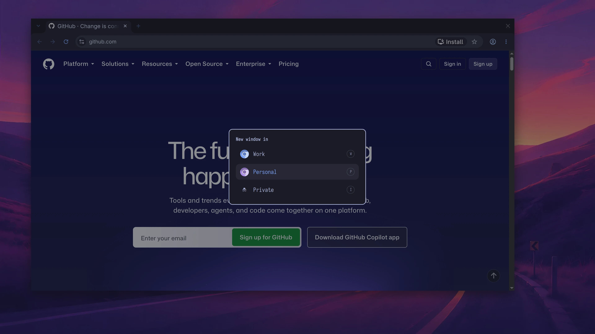

# Browser profile picker

An Omarchy overlay that asks which Chromium profile to use whenever a browser window or a link opens. It registers itself as the default web browser, so one change covers new windows and links from other apps.


## Requirements

- **Omarchy** with the shell plugin API (`omarchy plugin` and `omarchy-shell`).
- **Chromium.** Other Chromium-based browsers work if you set `browser` and `userDataDir` in the config.
- **`jq`**, which Omarchy installs.

## Install

The plugin and the default-browser setting are two steps. **`omarchy plugin add` installs only the overlay.** The `install` script then adds the `browser-picker` command and makes it the default browser.

```bash
omarchy plugin add https://github.com/kierangraham/browser-profile-picker --enable
~/.config/omarchy/plugins/kierangraham.browser-picker/install
```

The `install` script:

- copies `browser-picker` to `~/.local/bin`;
- adds `browser-picker.desktop` to `~/.local/share/applications`;
- enables the plugin if it isn't enabled yet;
- saves your current default browser, then sets the picker as the default.

To install without changing the default browser, run `install --no-default`. Then try it with `browser-picker https://example.com`.

**To update,** run `omarchy plugin update kierangraham.browser-picker`. Then run `install` again, because the update doesn't change the copy in `~/.local/bin`.

**From any other checkout,** `./install` is the only command you need. It also copies `manifest.json` and `Picker.qml` into `~/.config/omarchy/plugins/kierangraham.browser-picker/`. If that folder is already a git checkout from `omarchy plugin add`, it leaves the folder alone.

**To remove it,** run `uninstall` from the same folder. It restores the previous default browser and removes the plugin, the command and the desktop file. Your config file stays.

## Usage

The picker appears in two cases:

- **Super+Shift+Return** (or Super+Shift+B) runs Omarchy's `omarchy-launch-browser`, which runs the default browser. The picker opens with no URL, and your choice opens a new window.
- **Links from other apps** go through `xdg-open`, so they reach the picker with the URL.



Keys:

- **A letter or `1`–`9`** chooses directly. Each row shows its letter.
- **Up/Down, Tab or `j`/`k`, then Enter** moves and chooses.
- **Esc or a click outside** cancels.

**The highlight starts on the last choice** you made since the shell started.

**Super+Shift+Alt+B** (Omarchy's private-browser key) skips the picker and opens the Private choice.

**If the shell can't show the picker, the link opens in Chromium anyway.** The fallback runs when the shell isn't running or doesn't reply within 3 seconds. Chromium then uses its last profile.

The command also works on its own:

```text
browser-picker [URL]              show the picker
browser-picker --open ID [URL]    open in the choice with this id
browser-picker --private [URL]    open the private choice without asking
browser-picker --list             print the choices as JSON
```

## Choosing profiles

**With no config file, the picker lists your Chromium profiles.** It reads them from `~/.config/chromium/Local State`, in Chromium's own order and with the names Chromium shows. It adds **Private** at the end, which opens an incognito window in your last-used profile.

Run `browser-picker --list` to see the choices and their ids.

**To pick your own labels, order, keys or icons,** create `~/.config/browser-picker/profiles.json`. When this file lists any choices, the picker shows only those. [`profiles.example.json`](profiles.example.json) is a starting point:

```json
{
  "browser": "/usr/bin/chromium",
  "choices": [
    { "label": "Work", "profile": "Default", "key": "w", "icon": "~/.local/share/icons/work.svg" },
    { "label": "Personal", "profile": "Profile 1", "key": "p" },
    { "label": "Private", "profile": "Profile 1", "incognito": true, "key": "i" }
  ]
}
```

**`profile` is the folder name inside Chromium's data folder,** such as `Default` or `Profile 1`. It isn't the name Chromium shows. To find it, open `chrome://version` in that profile and read the last part of **Profile Path**.

Each choice takes these fields. Only `label` is required.

| Field | Default | What it does |
|---|---|---|
| `label` | | The text in the picker. |
| `profile` | Chromium's last-used profile | Passed as `--profile-directory`. |
| `incognito` | `false` | Adds `--incognito`. The first incognito choice is the one `--private` opens. |
| `key` | The label's first letter, if it's free | The shortcut key shown on the row. |
| `icon` | A Chromium or incognito glyph | An SVG or PNG path. `~` means your home folder. A missing file shows the glyph. |
| `glyph` | | A Nerd Font character to use instead of the default glyph. |
| `id` | The label in lower case, with dashes for spaces | The name for `--open`. |

Two top-level settings change the browser:

- **`browser`** is the command to run. Default: `/usr/bin/chromium`.
- **`userDataDir`** is where `Local State` is read from. Default: `~/.config/chromium`.

**Changes apply to the next window or link.** Nothing needs reinstalling.

## How it works

| Piece | Job |
|---|---|
| `browser-picker` | Works out the choices, summons the overlay and starts Chromium. It is the only file that knows Chromium's flags. |
| `manifest.json`, `Picker.qml` | The overlay. It shows the choices it is given and runs `browser-picker --open <id> [URL]`. It uses the Omarchy menu's theme colours. |
| `browser-picker.desktop` | The default-browser entry for `http`, `https` and HTML files. |
| `install`, `uninstall` | Set up or remove everything above. |

The overlay runs inside the long-lived `omarchy-shell` process, like the emoji picker and the Omarchy menu. It appears without starting a new program.

## Limits

- **Links clicked inside Chromium stay in Chromium.** This includes Chromium web apps such as Slack.
- **Omarchy's web-app launcher is unaffected.** It falls back to `chromium.desktop` when the default browser isn't a known Chromium build.
- **Chromium started some other way may offer to become the default browser again.** Choose **Don't ask again**.

## Development

```bash
./tests/run
omarchy plugin validate .
```

`tests/run` checks the plugin manifest, the choices, the Chromium arguments, the fallback, and both install routes. It uses a temporary home folder and stubs for `systemd-run`, `omarchy-shell` and `xdg-settings`, so it never touches your desktop.

## Licence

MIT. See [LICENSE](LICENSE).

---

[kierangraham.com](https://kierangraham.com)
