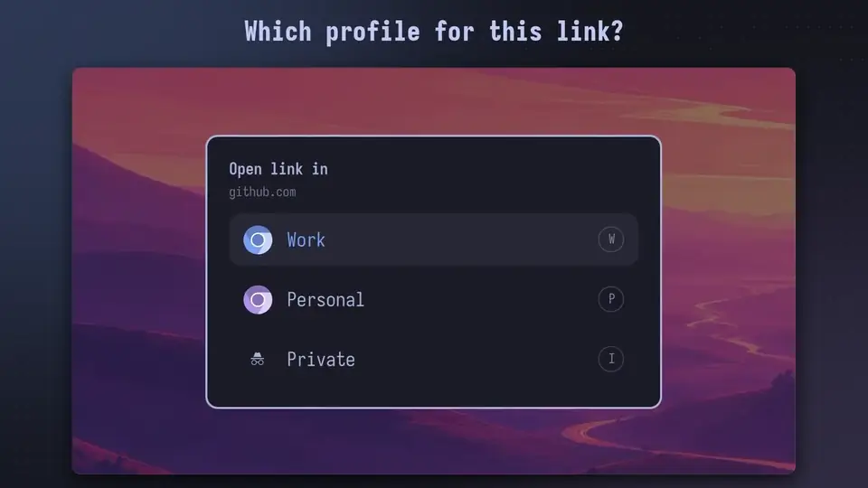
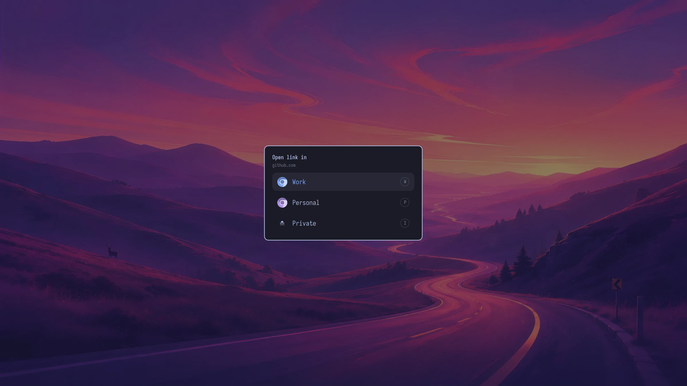

# Browser profile picker

An Omarchy overlay that asks which Chromium profile should open each link and new browser window.

[](https://kierangraham.com/media/promo/picker.mp4)

[Watch the film (25 s, with sound)](https://kierangraham.com/media/promo/picker.mp4)

It's for people who keep separate Chromium profiles, such as one for work and one for home. **The picker becomes your default web browser.** Links from other apps and new browser windows go through it, and it opens your choice in Chromium.

It is built for [Omarchy](https://omarchy.org) and runs inside the Omarchy shell.

## Install

**You need Omarchy.** It already includes Chromium, `jq` and `uwsm`, which the picker uses.

Installing takes three steps: the overlay, the `browser-picker` command, and the default-browser setting.

**1. Add the overlay** with Omarchy's plugin manager:

```bash
omarchy plugin add https://github.com/kierangraham/browser-profile-picker --enable
```

**2. Install the command.** The Arch package is the easiest route. It installs `browser-picker` and its desktop entry into `/usr`. **The package doesn't include the overlay,** because Omarchy manages its plugin folder itself.

```bash
sudo pacman -S --needed base-devel
git clone https://github.com/kierangraham/browser-profile-picker
cd browser-profile-picker/packaging/arch
makepkg -si
```

Without a package, run `make install` from the clone instead. It installs into `~/.local`:

```bash
git clone https://github.com/kierangraham/browser-profile-picker
cd browser-profile-picker
make install
```

**3. Make it the default browser.** Note the current default first, so you can switch back later:

```bash
xdg-settings get default-web-browser
xdg-settings set default-web-browser browser-picker.desktop
```

Test it by opening a link: `xdg-open https://example.com`.

## Update

Update the overlay:

```bash
omarchy plugin update kierangraham.browser-picker
```

Then update the command the same way you installed it. From your clone, either:

- **Package:** run `git pull`, then `makepkg -si` in `packaging/arch`.
- **`make install`:** run `git pull`, then `make install`.

## Uninstall

1. Restore your previous default browser. For Omarchy's Chromium:

   ```bash
   xdg-settings set default-web-browser chromium.desktop
   ```

2. Remove the overlay:

   ```bash
   omarchy plugin remove kierangraham.browser-picker
   ```

3. Remove the command. Use `sudo pacman -R browser-profile-picker` for the package, or `make uninstall` in your clone.

**Your config in `~/.config/browser-picker/` stays.** Delete it by hand if you don't need it.

## Usage

The picker opens in two cases:

- **Links from other apps** reach it through `xdg-open`. Your choice opens the link.
- **Super+Shift+Return or Super+Shift+B** runs Omarchy's `omarchy-launch-browser`, which starts the default browser. Your choice opens a new window.



| Key | Action |
| --- | --- |
| A row's letter, or `1`–`9` | Choose that row |
| Up/Down, Tab, or `j`/`k` | Move the highlight |
| Enter | Choose the highlighted row |
| Esc, or a click outside | Cancel |

**The highlight starts on your last choice** since the shell started.

**Super+Shift+Alt+B** is Omarchy's private-browser key. It skips the picker and opens the Private choice.

**If the shell can't show the picker, the link still opens.** This happens when the shell isn't running or doesn't reply within 3 seconds. Chromium then opens the link in its last-used profile.

The command also works on its own:

| Command | What it does |
| --- | --- |
| `browser-picker [URL]` | Show the picker |
| `browser-picker --open ID [URL]` | Open in the choice with this id, without asking |
| `browser-picker --private [URL]` | Open the private choice, without asking |
| `browser-picker --list` | Print the choices and their ids as JSON |

### Limits

- **Links clicked inside Chromium stay in Chromium.** This includes Chromium web apps, such as Slack.
- **Omarchy's web-app launcher is unaffected.** It falls back to `chromium.desktop` when the default browser isn't a Chromium build it knows.
- **Chromium may offer to become the default browser again** when something else starts it. Choose **Don't ask again**.

## Configuration

**With no config file, the picker lists your Chromium profiles.** It reads them from `~/.config/chromium/Local State`, with the names and order Chromium uses. It adds **Private** at the end. Private opens an incognito window in your last-used profile.

To choose your own labels, order, keys or icons, create `~/.config/browser-picker/profiles.json`. **When that file lists any choices, the picker shows only those.** Start from [`profiles.example.json`](profiles.example.json):

```json
{
  "browser": "/usr/bin/chromium",
  "choices": [
    { "label": "Work", "profile": "Default", "key": "w", "icon": "~/.local/share/icons/work.svg" },
    { "label": "Personal", "profile": "Profile 1", "key": "p" },
    { "label": "Private", "profile": "Profile 1", "incognito": true, "key": "i" }
  ]
}
```

**`profile` is the profile's folder name,** such as `Default` or `Profile 1`. It isn't the name Chromium shows. To find it, open `chrome://version` in that profile. The folder name is the last part of **Profile Path**.

Each choice accepts these fields. Only `label` is required.

| Field | Default | What it does |
| --- | --- | --- |
| `label` | | The text in the picker |
| `profile` | Chromium's last-used profile | Passed to Chromium as `--profile-directory` |
| `incognito` | `false` | Adds `--incognito`. `--private` opens the first incognito choice. |
| `key` | The label's first letter, if it's free | The shortcut shown on the row |
| `icon` | A Chromium or incognito glyph | An SVG or PNG file. `~` means your home folder. A missing file shows the glyph. |
| `glyph` | | A Nerd Font character to show instead of the default glyph |
| `id` | The label in lower case, with dashes for spaces | The name `--open` uses |

Two top-level settings change the browser:

| Setting | Default | What it does |
| --- | --- | --- |
| `browser` | `/usr/bin/chromium` | The browser command to run |
| `userDataDir` | `~/.config/chromium` | Where the picker reads `Local State` |

**Changes apply to the next link or window.** Nothing needs reinstalling.

## Development

```bash
make check
```

`make check` runs `tests/run`. The tests check the plugin manifest, the choices, Chromium's arguments, the fallback and `make install`. They use a temporary home folder and stand-ins for `systemd-run` and `omarchy-shell`, so they don't touch your desktop.

`make install` and `make uninstall` accept `PREFIX` (default `~/.local`) and `DESTDIR`.

To try overlay changes, commit them, then add your clone as the plugin:

```bash
omarchy plugin remove kierangraham.browser-picker
omarchy plugin add ~/path/to/browser-profile-picker --enable
```

The pieces:

| File | Job |
| --- | --- |
| `browser-picker` | Works out the choices, opens the overlay and starts Chromium. It is the only file that knows Chromium's flags. |
| `manifest.json`, `Picker.qml` | The overlay. It shows the choices it receives and runs `browser-picker --open <id> [URL]`. It uses the Omarchy menu's theme colours. |
| `browser-picker.desktop` | The default-browser entry for `http`, `https` and HTML files |
| `packaging/arch/PKGBUILD` | The Arch package for the command and desktop entry |

The overlay runs inside the long-lived `omarchy-shell` process, like Omarchy's emoji picker and menu. It appears without starting a new program.

## Licence

MIT. See [LICENSE](LICENSE).

---

[kierangraham.com](https://kierangraham.com)
